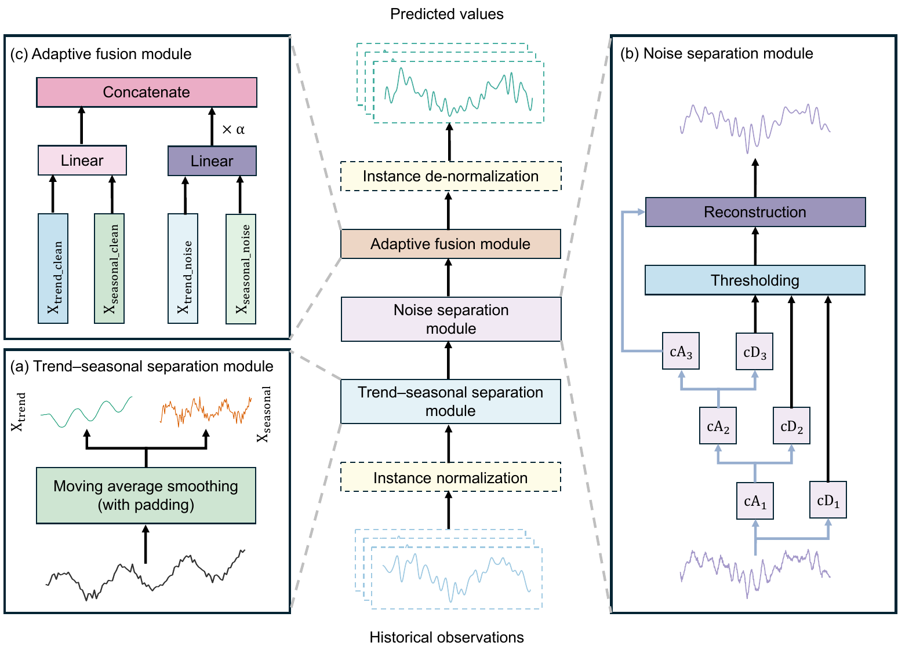

# NSAF (Computers & Geosciences 2027)

Official PyTorch implementation of [Noise-aware forecasting of land surface environmental time series via adaptive multi-scale fusion](https://doi.org/10.1016/j.cageo.2026.106303).

## Introduction

Hourly land surface observations contain trends and recurring patterns alongside rapid fluctuations from weather events, turbulence, and sensor noise. NSAF (Noise Separation and Adaptive Fusion) forecasts each variable from its own history.



- **Normalization and decomposition.** Reversible instance normalization uses statistics from each input window. A moving average then separates the trend from the seasonal component.
- **Wavelet-based noise separation.** Soft thresholding of wavelet detail coefficients produces denoised trend and seasonal signals. The differences from the original components form the residual signals.
- **Adaptive fusion.** NSAF forecasts the denoised and residual signals and uses a learned weight to control how much the residual forecast contributes.

## Quickstart

Use Python 3.8 and PyTorch 2.4.1.

```bash
git clone https://github.com/zafucslab/NSAF.git
cd NSAF
conda create -n NSAF python=3.8 -y
conda activate NSAF
python -m pip install -r requirements.txt

git clone https://github.com/fbcotter/pytorch_wavelets
cd pytorch_wavelets
pip install .
```

## Data preparation

The [bundled CSV](dataset/dataset.csv) is ready to use. It contains 10,911 hourly records from a high-elevation site on the Tibetan Plateau, with a `date` column and 25 measurement columns. The original observations are available from the [National Tibetan Plateau Data Center](https://data.tpdc.ac.cn/en/data/15281316-4024-4409-8c0f-f91e2f5b6574).

The loader uses a chronological 70/10/20 split for training, validation, and testing. It standardizes each variable using statistics fitted on the training partition.

## Train and evaluate

From the repository root, run the [batch script](scripts/NSAF_all.sh) to train and test 23 targets using the previous 96 hours to predict the next 96, 192, 336, or 720 hours (4, 8, 14, or 30 days).

```bash
bash scripts/NSAF.sh
```

To run one experiment, use the following command for a 96-hour forecast of air temperature at 1.5 m.

```bash
python -u run.py \
  --is_training 1 --model NSAF --model_id NSAF_Ta_1.5m_96 \
  --data custom --root_path ./dataset/ --data_path dataset.csv \
  --target Ta_1.5m --features MS --enc_in 25 \
  --seq_len 96 --pred_len 96 --cycle 24 --model_type linear \
  --batch_size 256 --train_epochs 10 --patience 5 --learning_rate 0.001 \
  --random_seed 2024
```
## NSAF configuration

| Argument | Example setting | Description |
| --- | --- | --- |
| `--target` | `Ta_1.5m` | Measurement column to forecast |
| `--seq_len` | `96` | Input window in hours |
| `--pred_len` | `96` | Forecast horizon in hours |
| `--cycle` | `24` | Length of the learned daily cycle in hours |
| `--wavelet` | `sym8` | Wavelet basis |
| `--dec_lev` | `4` | Wavelet decomposition depth |
| `--use_revin` | `1` | Enable reversible instance normalization |

## Citation

```bibtex
@article{WANG2027106303,
title = {Noise-aware forecasting of land surface environmental time series via adaptive multi-scale fusion},
journal = {Computers & Geosciences},
volume = {219},
pages = {106303},
year = {2027},
issn = {0098-3004},
doi = {https://doi.org/10.1016/j.cageo.2026.106303},
url = {https://www.sciencedirect.com/science/article/pii/S0098300426002001},
author = {Guoying Wang and Haoyu Wang and Hang Su and Lufeng Mo and Xiaomei Yi and Peng Wu},
```

## Acknowledgements

- The National Tibetan Plateau Data Center provides the source observations. [Dataset](https://data.tpdc.ac.cn/en/data/15281316-4024-4409-8c0f-f91e2f5b6574)
- NSAF uses Fergal Cotter’s implementation of the discrete wavelet transform. [PyTorch Wavelets](https://github.com/fbcotter/pytorch_wavelets)
